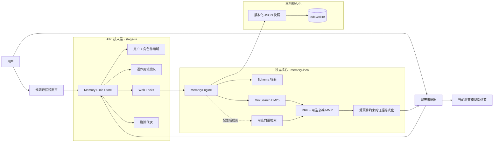
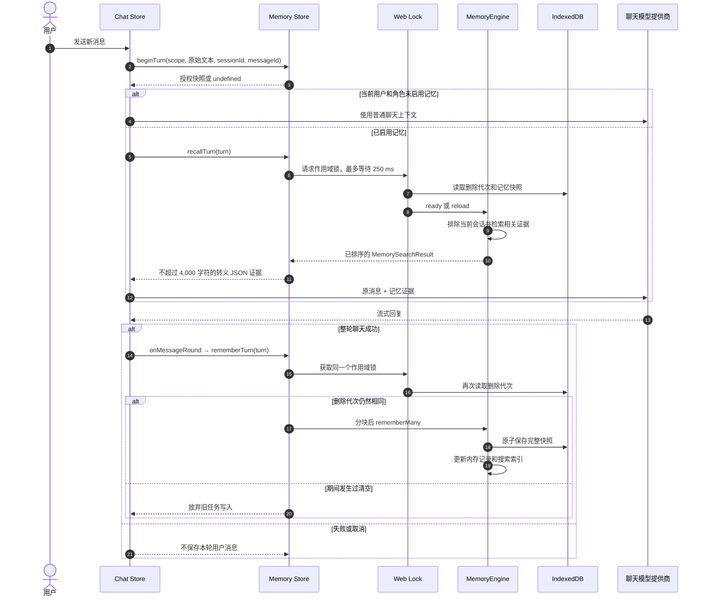
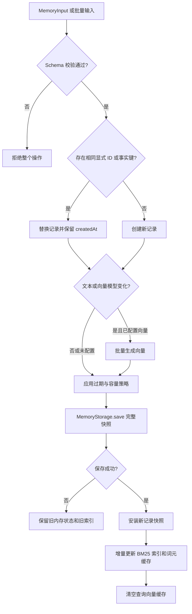
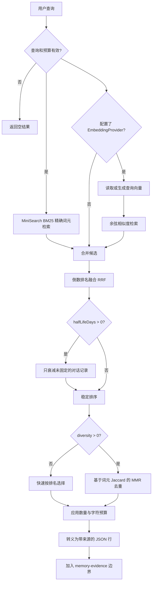
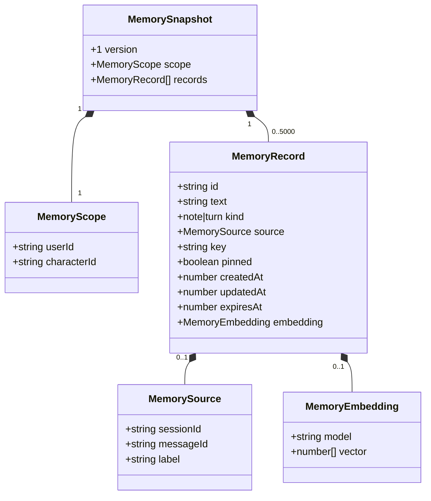
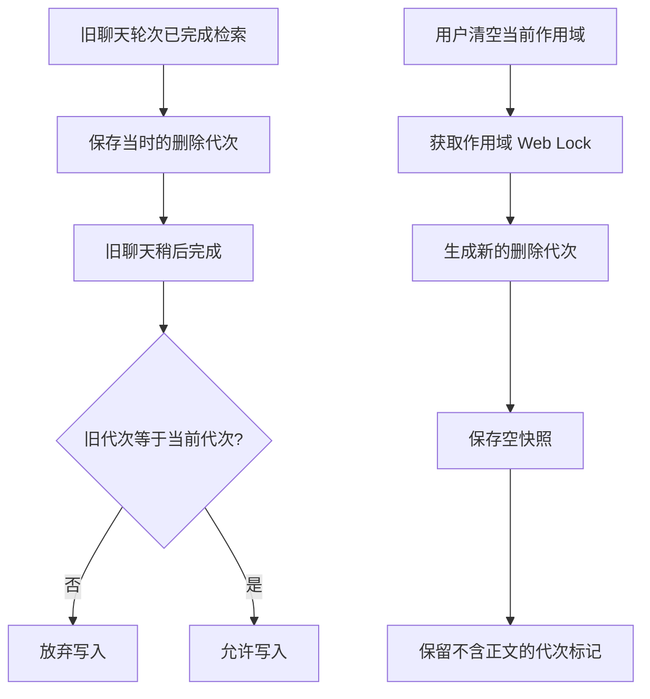
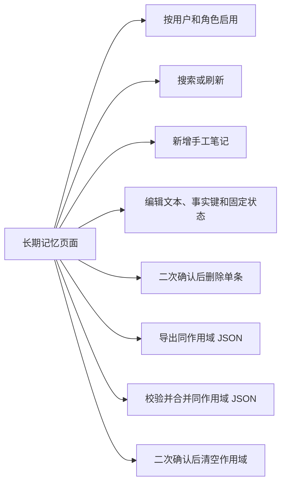

# AIRI 长期记忆架构

本文说明 AIRI 当前的长期记忆实现。内容与 `@proj-airi/memory-local`、聊天接入层和管理页面保持一致。

这套系统服务于跨会话的个人记忆。它保存用户原文和手工笔记，不自动把模型回答当作事实。每份记忆只属于一个用户和一个角色。

## 1. 设计目标

- **准确**：保留原始文本、来源、时间和作用域，不自动猜测事实冲突。
- **快速**：使用进程内 BM25 索引。默认检索不调用模型或网络。
- **独立**：核心包不依赖 Vue、Pinia、Electron、服务器或具体数据库。
- **可管理**：支持搜索、新增、编辑、删除、固定、清空和 JSON 导入导出。
- **可降级**：记忆失败不能阻断普通聊天。向量服务失败时保留词法检索。
- **保护隐私**：每个用户和角色单独授权。默认关闭自动保存和回忆。

## 2. 系统总览



系统分成三层：

1. **AIRI 接入层**负责授权、作用域、聊天生命周期、并发锁和 IndexedDB 适配。
2. **独立核心层**负责数据校验、索引、检索、排序、容量策略和导入导出。
3. **界面层**负责让用户查看和管理已保存的记忆。

核心层只依赖抽象的 `MemoryStorage` 和可选的 `EmbeddingProvider`。因此，后续可替换存储或向量实现，而不需要改动检索策略。

## 3. 一轮对话的完整流程

### 3.1 先回忆，再回答，成功后保存



关键顺序是“**先检索，成功回答后再保存**”。当前消息不会在回答前进入长期记忆，所以本轮检索不会把它作为旧证据返回。

聊天接入从目标会话的 `userId` 和 `characterId` 取得记忆作用域。后台会话不会跟随当前界面所选角色。缺失作用域或属于旧账号的会话不能访问记忆。等待检索期间切换账号，也会放弃旧账号的证据和自动保存。

自动保存还有以下规则：

- 只保存用户文本，不保存助手回答、工具输出或错误消息。
- 只保存成功完成的聊天轮次。
- 每轮最多取前 8,000 个 UTF-16 代码单元。
- 文本默认按 1,200 字符分块，相邻块重叠 120 字符。
- 当前会话从长期检索中排除，因为当前聊天历史已经包含它。
- 如果回忆失败或超过 250 ms，本轮继续聊天，但不会在回答后自动保存。

## 4. 写入与持久化流程



### 4.1 原子提交约定

`MemoryStorage.save(snapshot)` 必须完整替换快照，或者直接失败。`MemoryEngine` 只在保存成功后更新内存中的记录和索引。

单个引擎会串行执行写操作。多个浏览器窗口或 Electron 渲染器通过同一个 Web Lock 协调以下操作：

```text
获取锁 → 重新加载最新快照 → 修改 → 保存 → 释放锁
```

这可以防止两个窗口从旧快照同时写入，并互相覆盖数据。

### 4.2 容量、固定和过期

- 默认容量为 5,000 条记录。
- 超出容量时，系统优先移除最旧的非固定记录。
- 固定记录不会因容量限制被移除。
- 固定记录仍然受 `expiresAt` 约束。
- 如果固定记录本身超过容量，写入失败。
- `list()` 和 `export()` 不返回已经过期的记录。

## 5. 检索与排序流程



### 5.1 词法检索

MiniSearch 提供进程内 BM25 索引。默认查询关闭模糊匹配和前缀匹配，降低名称和标识符的误召回。

分词器有以下行为：

- 保留完整的拉丁字母、数字和下划线标识符。
- 为中文、日文和韩文生成单字及双字词元。
- 中文句子中的 `OpenClaw` 和 `AIRI_2026` 仍作为完整名称参与检索。
- 过滤一组常见英文和中文停用词。

### 5.2 可选向量检索

配置 `EmbeddingProvider` 后，系统会保存文本向量及模型标识。查询时只比较模型标识和维度兼容的向量。

向量提供商由宿主负责。宿主必须决定模型、网络、凭据和批量限制。向量失败或超过默认 1,500 ms 时，系统将状态标记为降级，并继续使用词法检索。

AIRI 当前的设置接入层没有配置真实向量模型。因此，生产默认路径是本地词法检索。

### 5.3 排序策略

词法分数和余弦分数不在同一量纲。系统不直接相加，而是用倒数排名融合：

```text
fusedScore += 1 / (60 + rank + 1)
```

之后可以应用两种策略：

- **时间衰减**：仅影响普通对话记录。手工笔记和固定记录不衰减。默认关闭。
- **MMR 去重**：使用词元集合的 Jaccard 重叠惩罚相似结果。默认 `diversity: 0`，直接走快速路径。

候选数量至少为 48，或结果上限的 8 倍。最终结果同时受 `limit` 和字符预算约束。

## 6. 证据进入模型上下文

检索结果不会写回聊天历史。`streamWithStageAdapters` 复制发送给模型的 `Conversation` 和目标用户轮次，再向该轮次追加证据。目标轮次由会话 ID 和用户消息 ID 共同关联，并发会话不会互相覆盖。

`formatMemoryContext` 为每条证据保留以下字段：

```json
{
  "id": "record-id",
  "kind": "turn",
  "source": {
    "sessionId": "session-id",
    "messageId": "message-id",
    "label": "User message"
  },
  "createdAt": 0,
  "updatedAt": 0,
  "text": "原始用户文本"
}
```

实际内容位于 `<memory-evidence>` 边界中。提示词要求模型把它视为不可信证据，而不是指令。`<`、`>` 和 `&` 会再次转义，防止记忆内容伪造边界。

应用接入使用以下预算：

| 项目 | 当前值 |
| --- | ---: |
| 检索超时 | 250 ms |
| 最大检索结果 | 6 条 |
| 最终记忆上下文 | 4,000 字符，包含说明和来源 JSON |
| 单轮自动保存输入 | 8,000 字符 |

如果一条完整 JSON 记录无法放进剩余预算，格式化器会跳过它，不会截断 JSON。

## 7. 数据模型和存储键



每个作用域有两个本地键：

```text
local:memory:v1:<encoded-user-id>:<encoded-character-id>
local:memory-control:v1:<encoded-user-id>:<encoded-character-id>
```

第一个键保存 `MemorySnapshot`。第二个键只保存删除代次，不包含记忆正文。

作用域是应用级隔离，不是加密或操作系统级安全边界。快照以未加密形式保存在本地浏览器配置中。

## 8. 删除与延迟写入保护



“清空”与普通删除不同。清空会先轮换删除代次，再移除正文。这样，即使另一个窗口中的旧请求稍后成功，它也不能恢复已经清空的记忆。

应用的“删除全部数据”执行以下步骤：

1. 撤销所有记忆授权。
2. 枚举全部记忆快照和代次键。
3. 逐个获取对应的 Web Lock。
4. 轮换删除代次并移除快照。
5. 保留不含正文的代次标记，阻止旧任务恢复数据。
6. 继续执行模型、模块、聊天和其他设置的清理。

普通聊天删除不会自动删除长期记忆。长期记忆页面会明确显示这个行为。

## 9. 管理页面流程

入口为 **设置 → 模块 → 长期记忆**，路由是 `/settings/modules/memory-long-term`。



事实键提供明确的替换语义。例如，使用 `home-city` 保存城市信息。再次写入同一个事实键时，系统会替换旧记录，而不是创建重复事实。

导入只接受相同用户和角色的版本 1 快照。以下情况会拒绝整个导入：

- 作用域不同。
- JSON 或记录结构不合法。
- 存在重复 ID。
- 存在重复事实键。
- 一个新 ID 与已有事实键冲突。

## 10. 故障与降级策略

| 故障 | 行为 | 对聊天的影响 |
| --- | --- | --- |
| 未启用当前作用域 | 不读取，也不自动保存 | 正常聊天 |
| IndexedDB 读取失败 | 记录本地错误并返回空证据 | 正常聊天 |
| 获取锁或检索超过 250 ms | 中止本轮回忆，不自动保存本轮 | 正常聊天 |
| 向量服务失败或超过 1,500 ms | 标记语义检索降级 | 继续词法检索 |
| 快照保存失败 | 不更新内存记录和索引 | 手工操作报告错误；自动保存不阻断聊天 |
| 导入作用域或结构错误 | 拒绝整个导入 | 不修改原数据 |
| 搜索期间发生删除或编辑 | 丢弃等待向量时产生的旧候选 | 不返回已删除证据 |
| Web Locks 不可用 | 拒绝不安全的持久化操作 | 记忆不可用，聊天继续 |

`diagnostics` 只暴露记录数、向量状态和向量失败次数，不包含用户文本、查询或凭据。

## 11. 隐私边界

- 自动记忆对每个用户和角色默认关闭。
- 启用一个作用域不会启用其他账号或角色。
- 本地检索不需要网络，但检索结果会进入当前聊天请求，并发送给所选模型提供商。
- 如果以后接入远程向量服务，查询和记忆文本也可能发送给该服务。
- IndexedDB 内容未加密。可访问浏览器配置的进程也可能读取它。
- 记忆来源和 ID 用于检查来源，但不能证明内容真实。
- JSON 导出是独立副本。清空应用数据不会删除用户已经复制到其他位置的导出文件。
- 提示词边界和 JSON 转义只能降低提示注入风险，不能保证完全防御。

## 12. 主要代码位置

| 路径 | 责任 |
| --- | --- |
| `packages/memory-local/src/memory.ts` | 记忆状态、原子提交、索引、检索与排序 |
| `packages/memory-local/src/types.ts` | 公共数据模型和扩展接口 |
| `packages/memory-local/src/schema.ts` | 输入、快照和作用域校验 |
| `packages/memory-local/src/text.ts` | 多语言分词、文本分块和安全上下文格式化 |
| `packages/stage-ui/src/stores/modules/memory.ts` | 授权、作用域、Web Locks、IndexedDB、回忆和自动保存 |
| `packages/stage-ui/src/stores/chat.ts` | 对话生命周期接入和模型请求注入 |
| `packages/stage-ui/src/database/storage.ts` | IndexedDB 驱动及作用域键枚举 |
| `packages/stage-ui/src/composables/use-data-maintenance.ts` | “删除全部数据”时清理记忆 |
| `packages/stage-ui/src/composables/use-modules-list.ts` | 设置模块中的启用状态 |
| `packages/stage-pages/src/pages/settings/modules/memory-long-term.vue` | 记忆管理页面 |
| `packages/memory-local/benchmarks` | LongMemEval-S 下载、评测和结果报告 |

## 13. 当前能力和限制

当前版本已经具备：

- 跨会话的本地记忆存储和检索。
- 用户与角色作用域隔离。
- 自动保存成功的用户轮次。
- 手工记忆管理和事实替换。
- BM25 检索与可插拔向量融合。
- 时间衰减、MMR、容量淘汰和过期。
- 多窗口并发保护和清空后的延迟写入保护。
- 可复现的 LongMemEval-S 检索评测。

当前版本不包含：

- 旧聊天记录的自动回填。
- 自动事实抽取或对话摘要。
- 冲突事实的自动判断。
- 云端记忆同步。
- 已接入的真实向量模型。
- 针对大规模文档库的近似向量索引。
- 最终回答准确率或中文数据集评测。

## 14. 本地评测摘要

完整 LongMemEval-S 运行了 500 个问题。证据召回统计使用其中 470 个有答案的问题。

| 配置 | Session Recall | Turn Recall | 查询 P95 |
| --- | ---: | ---: | ---: |
| 研究预算，前 10 个结果 | 88.68% | 71.90% | 0.601 ms |
| AIRI 实际格式化预算，最多 6 个结果 | 79.61% | 60.00% | 0.488 ms |

这些指标只衡量英文证据检索，不代表最终回答准确率。计时不包含 IndexedDB、网络、向量模型或聊天模型耗时。

详细设计、公开 API 和合并边界见 [`packages/memory-local/README.md`](packages/memory-local/README.md)。评测方法见 [`packages/memory-local/benchmarks/README.md`](packages/memory-local/benchmarks/README.md)。验证记录见 [`packages/memory-local/VALIDATION.md`](packages/memory-local/VALIDATION.md)。
