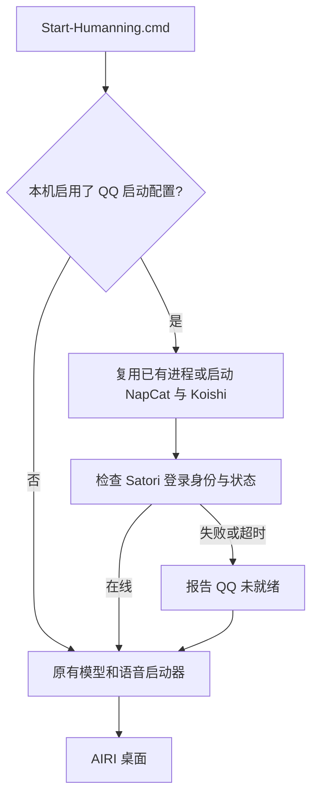

# Windows 一键启动 AIRI 与 QQ

日期：2026-10-24。适用于已经准备好本地模型、NapCat、Koishi 和 AIRI QQ 接入模块的 Windows 环境。

## 启动方式与状态

直接打开 AIRI，只会连接已经运行的 QQ 转接服务。
这次更新后的 `Start-Humanning.cmd` 会先启动或复用 NapCat、Koishi，再启动原有模型、语音服务和 AIRI。
本机已经保存对应启动路径，后续双击仓库根目录的 `Start-Humanning.cmd` 即可。

启动器通过带令牌的 Satori `login.get` 检查小号身份、平台和在线状态。
端口开放不等于 QQ 已登录，也不等于 AIRI 已完成一次收发。
`already_ready` 表示 QQ 已在线，启动器没有再创建一组服务。



QQ 不可用时，AIRI 仍会启动。终端会明确报告 QQ 未就绪。
模型或语音服务的启动失败仍会返回失败退出码。
启动器不会更改模型、声音、上下文预算、QQ 静默时段或联系人白名单。

## 首次准备

1. 安装 NapCat 和 Koishi。
2. 在 NapCat 登录交给角色使用的小号。
3. 在 Koishi 配置 `adapter-onebot` 和 `server-satori`。
4. 在 AIRI 的本地 `companion/qq.json` 配置固定联系人和 Satori 地址。
5. 把 `configs/local-qq-startup.example.json` 复制为工具目录中的 `qq-startup.json`。
6. 在新文件中填写实际路径，并把 `enabled` 改为 `true`。
7. 双击 `Start-Humanning.cmd`。

默认工具目录是仓库上一级的 `.tools`，不是仓库内部。
默认 AIRI 配置为该目录下的 `airi-stage1-desktop-profile/companion/qq.json`。
配置模板中的相对路径，以 `qq-startup.json` 所在目录为基准。

### 启动路径配置

| 字段 | 用途 |
| --- | --- |
| `enabled` | 是否由此入口启动 QQ 服务 |
| `qqConfig` | 已有 AIRI `qq.json` 的路径 |
| `waitSeconds` | 等待 QQ 在线的时限，默认 90 秒，可设置 1 至 300 秒 |
| `napcat.command` | NapCat 可执行文件和参数的数组，第二项是小号 QQ ID |
| `napcat.cwd` | `NapCatWinBootMain.exe` 所在目录 |
| `napcat.port` | 已配置的 OneBot WebSocket 端口，默认 3001 |
| `koishi.command` | Koishi 运行时、目标实例的 `koishi/bin.js`、`start` |
| `koishi.cwd` | 目标 Koishi 实例的目录 |

命令必须使用直接的 `.exe` 入口。启动器不通过 shell 执行配置字符串。
Koishi Desktop 的运行时入口是安装目录下的 `Desktop/bin/koishi.exe`。
默认实例的 CLI 在用户数据目录的 `Koishi/Desktop/data/instances/default/node_modules/koishi/bin.js`。
只需填写已经安装的路径，启动器不会下载或安装这些应用。

`qq-startup.json` 不需要复制令牌。
启动器从现有 AIRI `qq.json` 读取 Satori 令牌，只发送给本机回环 HTTP 地址。
NapCat WebUI、OneBot 和 Satori 的令牌用途不同，不能混用。
配置、账号、令牌、二维码、消息和运行日志均只留在本机，不上传 GitHub。

## 登录与重复启动

NapCat 的快速登录使用之前保存的登录状态。
首次登录、状态过期或 QQ 要求验证时，仍需要本人扫码确认。
启动器不会绕过扫码或验证码，也不承诺永久免登录。

如果提示 `login-required`，打开本机 [NapCat WebUI](http://127.0.0.1:6099/webui/) 完成登录。
登录完成后，再运行一次 `Start-Humanning.cmd`。
已有进程会复用，不需要把三个应用全部关闭。

如果提示 `authentication-failed`，检查本地 `qq.json` 与 Koishi 的 Satori 令牌是否一致。
如果提示 `account-mismatch`，检查 `selfId` 和 `platform`。
Koishi OneBot 转接的 `platform` 使用 `onebot`。

启动器不会结束已有 QQ 或 Koishi 进程。
进程检查失败时，也不会盲目启动重复实例。
关闭启动窗口后，服务继续运行。此功能不是 Windows 开机自启，也不是持续进程守护。

## 命令行入口

以下命令在仓库根目录执行，使用已经准备好的 Python。

```powershell
# 只检查本地文件，不联网、不启动应用。
.\local-models\airllm-cuda-venv\Scripts\python.exe -B scripts/start-local-companion.py --check

# 只启动或复用 QQ 服务，不启动模型和 AIRI。
.\local-models\airllm-cuda-venv\Scripts\python.exe -B scripts/start-local-companion.py --qq-only

# 本次跳过 QQ 服务启动，保留原有模型和语音启动行为。
.\Start-Humanning.cmd --skip-qq-startup

# 使用其他本机启动路径配置。
.\Start-Humanning.cmd --qq-config D:\PRIVATE\qq-startup.json
```

`--skip-qq-startup` 只跳过拉起服务，不会关闭已有 QQ 连接。
如果需要停用 AIRI 的 QQ 接入，把本地 `companion/qq.json` 的 `enabled` 改为 `false`，再重启 AIRI。
原有模型和声音参数继续传给 `scripts/start-local-voice.py`。
直接运行该旧脚本不会拉起 QQ 服务。`--services-only` 也只启动模型和语音服务。

`--qq-only` 仅在确认在线时返回 0。未配置、登录失败和超时均返回非零。
`--check --qq-only` 只证明配置路径有效，不检查在线状态。

## 日志与验收范围

QQ 启动日志保存在工具目录的 `local-qq-logs`，模型和桌面日志仍在 `local-voice-logs`。
日志能包含登录提示和二维码地址，不应提交到版本库。
本机 QQ 接收、模型回复和投递记录仍由 AIRI 原有 `companion/qq-inbox` 与 `qq-outbox` 保存。

本次验证了以下场景：

- 真实已登录账号返回 `already_ready`，重复执行不创建新服务。
- 使用真实受控子进程验证冷启动、路径含空格及再次执行时的复用。
- 检查令牌错误、账号不符、登录超时、HTTP 重定向和系统代理隔离。
- 检查 QQ 失败后仍启动 AIRI，以及原有 Windows 启动回归测试。

没有退出真实 QQ 账号来测试登录失效，也没有为了本次启动验证发送新消息。
本机之前已经完成真实文字收发测试。新机器仍需完成自己的接入和收发验收。
本次 GitHub 发布只包含启动入口、测试、配置模板和这份说明，不包括工作区其他未提交的记忆、视觉和角色改动。

检查命令：

```powershell
python -B scripts/test-local-companion-launcher.py -v
python -B scripts/test-local-voice-launcher.py -v
pnpm --config.verify-deps-before-run=false lint
```

本次执行结果：

| 环境 | QQ 启动测试 | 原有语音启动测试 |
| --- | --- | --- |
| 当前本机工作区 | 19 项通过 | 31 项通过 |
| GitHub main 基础上的准确发布快照 | 19 项通过 | 22 项通过 |

两组环境的测试数量不同，因为本机还存在这次没有发布的其他功能改动。
全仓 lint 为 0 errors、655 warnings，没有为清理既有警告修改无关代码。

